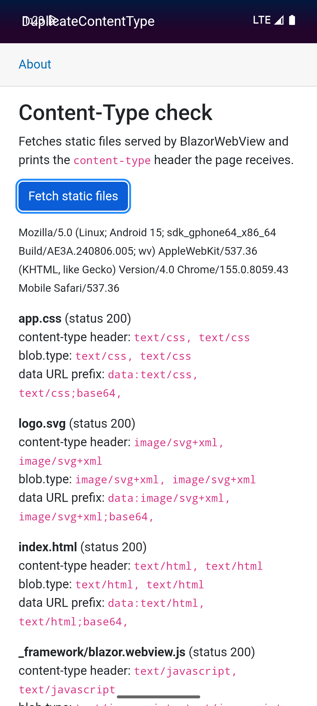

# BlazorWebView on Android sends every static file with a doubled Content-Type header

Minimal reproduction for a .NET MAUI `BlazorWebView` bug on Android: every static file the WebView serves from the app comes back with the `Content-Type` header twice, so the page sees `text/css, text/css` instead of `text/css`.

- Issue: ISSUE_LINK

The value is wrong everywhere the page can read it, not only in the header: `Blob.type` is the same comma-joined string, and so is the MIME type of a data URL built from the response with `FileReader.readAsDataURL`:

```
data:image/svg+xml, image/svg+xml;base64,PHN2ZyB4bWxucz0i...
```

Any code that parses that data URL by splitting on the first comma (for example the [html-to-image](https://www.npmjs.com/package/html-to-image) library) then reads a corrupted payload.

## What the app does

`dotnet new maui-blazor` (MAUI 10.0.120) reduced to one page. The **Fetch static files** button calls [`wwwroot/contentTypeCheck.js`](wwwroot/contentTypeCheck.js), which `fetch()`es four files the app serves itself and prints for each one:

- the `content-type` response header
- `Blob.type` of the response body
- the prefix of the data URL produced by `FileReader.readAsDataURL`

The files are `app.css`, `logo.svg` and `index.html` from `wwwroot`, and the framework's own `_framework/blazor.webview.js`. The same lines are written to logcat (tag `DOTNET`) and to the browser console.

## Steps to reproduce

1. Clone this repository.
2. Build and run it on an Android emulator or device:
   ```
   dotnet build -t:Run -f net10.0-android
   ```
3. Tap **Fetch static files**.
4. Read the result on screen, or in logcat: `adb logcat -s DOTNET`.

## Expected

One value per header, as on Windows:

```
app.css: content-type header 'text/css', blob.type 'text/css', data URL prefix 'data:text/css;base64,'
```

## Actual (Android)

Android 15 emulator (`sdk_gphone64_x86_64`), Android System WebView 155.0.8059.43, MAUI 10.0.120:

```
[content-type-check] app.css: content-type header 'text/css, text/css', blob.type 'text/css, text/css', data URL prefix 'data:text/css, text/css;base64,'
[content-type-check] logo.svg: content-type header 'image/svg+xml, image/svg+xml', blob.type 'image/svg+xml, image/svg+xml', data URL prefix 'data:image/svg+xml, image/svg+xml;base64,'
[content-type-check] index.html: content-type header 'text/html, text/html', blob.type 'text/html, text/html', data URL prefix 'data:text/html, text/html;base64,'
[content-type-check] _framework/blazor.webview.js: content-type header 'text/javascript, text/javascript', blob.type 'text/javascript, text/javascript', data URL prefix 'data:text/javascript, text/javascript;base64,'
```



## Platforms

| Platform | Result |
| --- | --- |
| Android 15 emulator, WebView 155 | Doubled (shown above) |
| Windows 11, WebView2 156 | Single value, see [docs/windows-actual.png](docs/windows-actual.png) |
| iOS | Single value, observed in a production app; not run with this repository |

## Cause

[`WebKitWebViewClient.GetResponse`](https://github.com/dotnet/maui/blob/418cecf802ae4f25bb7e2bcd5a2cd59ed1a63c73/src/BlazorWebView/src/Maui/Android/WebKitWebViewClient.cs#L218-L222) passes the content type as the `mimeType` argument of `WebResourceResponse` and also leaves it in the `responseHeaders` map:

```csharp
var contentType = headers["Content-Type"];
...
return new WebResourceResponse(contentType, "UTF-8", statusCode, statusMessage, headers, content);
```

Android WebView writes the `mimeType` argument as a `Content-Type` header and then appends every entry of `responseHeaders`, so the response carries two `Content-Type` headers and the page reads them joined with a comma.

## Workaround

No clean one. Code that consumes the values can normalize them, e.g. keep only the part of `Blob.type` before the first comma.

`BlazorWebView.WebResourceRequested` does not help as is: `e.SetResponse(...)` builds the Android response the same way and doubles the header too. Only setting `e.PlatformArgs.Response` to a hand-built `Android.Webkit.WebResourceResponse` whose headers map has no `Content-Type` avoids it, which means serving those files yourself.
